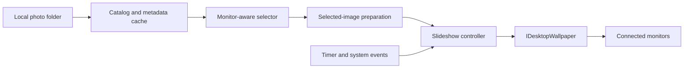

# Architecture

AspectSlide is one per-user Windows Forms process. It creates a tray icon and opens its settings window on manual launch. It runs no Windows service and needs no administrator privileges.

## Components

- **Catalog:** Recursively scans ordinary folders, rejects network paths and links, and skips cloud-only files. `ImagePhotoProbe` reads image dimensions and EXIF orientation with Windows' built-in GDI+ image handling. Metadata is cached by path, size, and modification time. `FileSystemWatcher` debounces changes, and a daily reconciliation scan repairs missed events.
- **Selector:** Scores images by orientation, aspect ratio, and required upscaling. It assigns the monitor with the least flexibility first, avoids duplicate files within a batch when possible, and uses recent history and bounded randomness to vary choices.
- **Image preparation:** Leaves usable JPEG, PNG, and BMP sources untouched. Converts a selected image to an app-owned JPEG only when its format or EXIF rotation requires it. The cache prunes only inactive app-owned files when it exceeds its size limit.
- **Controller:** Owns the one-shot timer, pause state, display and wake events, and the batch gate. It prepares every selected path before a wallpaper write, rechecks monitor topology and pause/stop state, then calls the wallpaper API on the UI STA thread. Recoverable failures schedule a retry while preserving the last successful wallpaper.
- **Windows adapter:** Wraps `IDesktopWallpaper` for attached-monitor IDs, wallpaper paths, slideshow status, and the system-wide Fill/Fit position.
- **Settings:** Saves state atomically in the current user's local app data. Before the first change, it records the original wallpaper paths and position for explicit restoration.

## Safety boundaries

Scanning and preparation never write to the source photo tree. The app never changes the Windows accent-color registry: its Colors button opens Windows Settings, where the user can choose Automatic. The default automated tests use a fake wallpaper adapter; the opt-in real COM test is read-only. Tests that actually set wallpaper require an interactive desktop and are performed manually.
